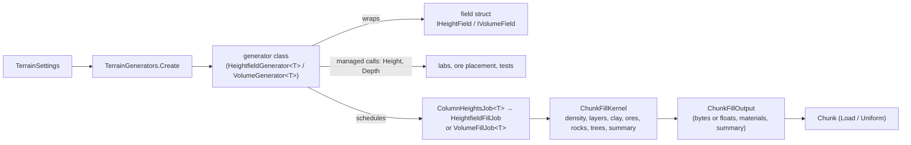
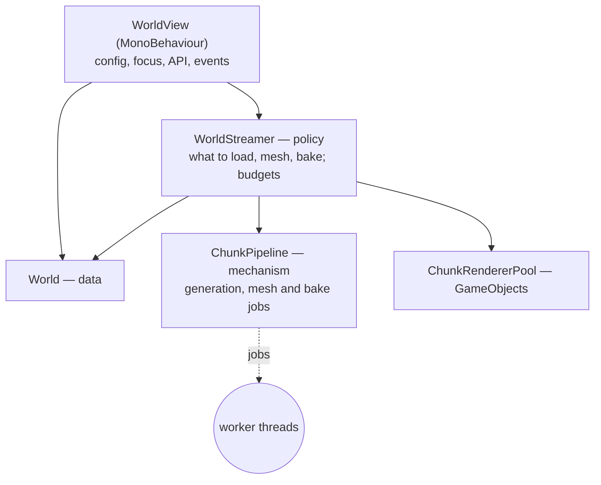
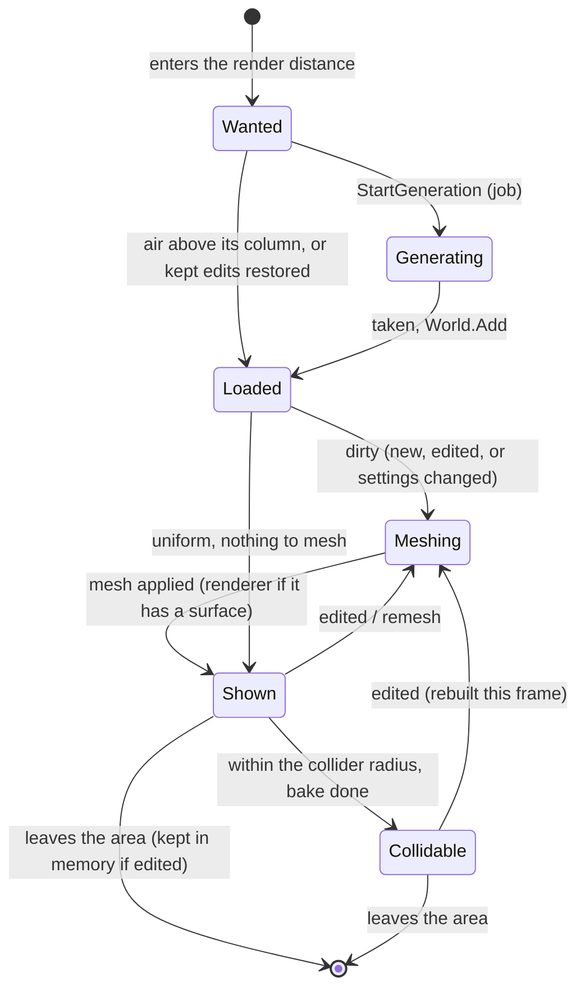
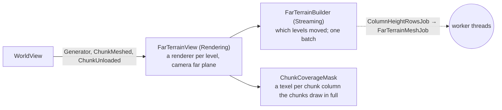
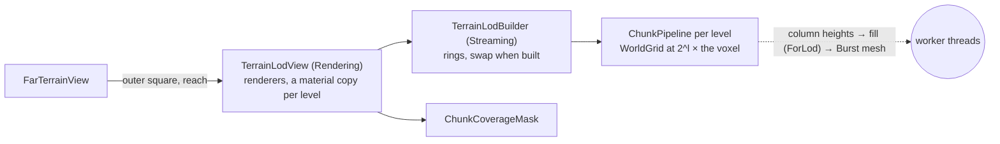

# clube — Architecture

How the code is put together, why, and where new work goes. The plan and the
rules it follows (A1–A13, G1–G5) are in [clube-objectives.md](clube-objectives.md);
measurements are in [benchmarks.md](benchmarks.md). This file is the map
between them: read it before changing how the world is generated, meshed or
streamed, or before adding a new game system.

*Written 2026-10-05, with the chunk pipeline (K35, P1–P3). Keep it current:
when a section stops matching the code, fix the section in the same PR.*

---

## 1. The big picture

Three assemblies (A1). Core is the engine; the labs and the game are both
just users of it.


Inside Core, code is grouped by **layer**, and each layer only uses the ones
below it:

| Layer | Folders | Knows about Unity objects? | Runs on |
|---|---|---|---|
| Presentation | `Rendering/` | Yes: MonoBehaviours, meshes, colliders | Main thread |
| Runtime | `Streaming/` | Mesh data and job handles only | Main thread, schedules jobs |
| Algorithms | `Generation/`, `Meshing/`, `Editing/`, `Queries/`, `Volume/`, `Saving/`, `Sky/`, `Fauna/` | No (structs, static code, managed reference paths) | Jobs or main thread |
| Data | `Voxels/`, `World/`, `Materials/`, `Items/`, `Crafting/`, `Economy/`, `Skills/`, `Quests/`, `Config/` | Only ScriptableObjects for definitions | Main thread |

The rule that keeps this tidy: **data and algorithms never reach up.** A
`Chunk` doesn't know it is drawn; a generator doesn't know about chunks; the
streamer doesn't know about lab tools. Debug code hooks the events Core raises
(A4) — `WorldView.ChunkLoaded`, `ChunkMeshed`, `IRenderedChunk.MeshRebuilt` —
and never the other way round.

### Folder map (Core)

```
Core/
  Config/        WorldConfig (A2), ChunkSizing (M25)
  Voxels/        Chunk (also water per sample, GL315), IVoxelStorage + schemes (2G), VoxelMaterials (M10), VoxelArrayPool, VoxelBox
  World/         World (loaded chunks, borders, edit paths), WorldGrid (coordinates)
  Materials/     VoxelMaterial, MaterialRegistry (M9), TerrainLayers, MaterialCensus, MineralNotes (GL73)
  Items/         ItemDefinition (O6), ToolDefinition (GL1), Inventory + ItemStack (GL6), Composition (GL32),
                 ToolRepair (mending with ingots, GL286), TorchDefinition (GL287)
  Crafting/      Recipe, CraftingStation (GL8; fixed batches GL61, fuel GL35)
  Economy/       Wallet, PriceList (GL12, GL13), ShopSpecialty (what a town shop buys, sells and teaches; its prices come
                 from the one PriceList, GL401), ShopHours (a keeper's day: counter, chores, sleep, GL404-GL406)
  Skills/        SkillSet: experience and levels per skill (GL47), MiningJournal (GL73), SkillTraining (lessons for coins, GL402)
  Quests/        QuestLog: the checklist in sections, done once each (GL216); what counts is decided in Game (PlayerQuests)
  Generation/    TerrainSettings, ITerrainGenerator, TerrainGenerators, ChunkGenerator, TerrainSurface (GL56)
    Generators/  managed generator classes (Flat, Sine, FractalPerlin2D, Spline, Perlin3D)
    Map/         the bounded map (GL589-GL592): MapDefinition, MapLayout, MapBoundaryType, MapShape, BiomeDefinition,
                 BiomeField, BiomeMap, ResourceSurvey, SurveyResource + ResourceReach (GL595)
    Heightmaps/  Heightmap import, HeightmapGenerator, HeightmapExport (K29)
    Noise/       PerlinNoise (struct), VoxelHash, ErosionFilter + ErosionSettings (gullies as a filter on a heightfield, P12a)
    Rocks/       BoulderField (large faceted boulders, stamped as TreePart.Boulder parts with the trees, GL342)
    Fields/      the Burst shapes: IHeightField / IVolumeField structs
    Fill/        generation jobs and the shared ChunkFillKernel; SlopeRidges (ridges down slopes in the density, GL293)
    Water/       WaterGeneration (settings), Hydrology (drains the heightfield), WaterMap (rivers and lakes as job data, GL307),
                 WaterFill (the map's water into a loaded chunk's samples, GL315)
    Ores/        OreSpec, OreField (placement), OreRoll (the roll, shared)
    Trees/       TreeGeneration (settings), TreeField (placement), TreeShape (one tree), TreeStamp (into a chunk, GL30)
    Settlements/ TownSiteSearch + TownSiteFinder (where the town stands: a parcel near ores and water, from the seed, in steps, GL399),
                 TownPlan (one town worked out once: frame, shop pads, wall stones, mine shafts, GL408-GL414), TownStructures
                 (the shapes: wall stones, a shop's voxels, a shaft's stair line and passage),
                 TownLayout (the town's plan: wall, gate, shop plots, keeper spots, cobbled paths, GL400, GL405, GL407)
                 CartRoute (the trade cart's road to a distant town 10+ parcels out of the gate: bends moved to the least climb, GL477)
    Flora/       GrassGrowth (grass height, wheat fields, GL234-GL235), BushGrowth (where bushes grow, sizes, drops, GL236),
                 TreeCover (how thick the grown trees stand round a place)
  Meshing/       MarchingCubes + tables, ChunkMeshSettings, variants (A6)
    Managed/     ChunkMesher and its strategies, the managed material pass: labs, step-through (A11)
    Jobs/        ChunkMeshJob: the Burst mesh build the world runs; CarvedVoxels: walls round chiselled voxels (GL92)
    Far/         FarTerrainGrid (one clipmap level), FarTerrainMeshJob (its mesh): the far terrain (P7a)
    Water/       WaterMesher: marching cubes over a chunk's water samples (managed, per wet chunk, GL315)
                 WaterSheetMesh: a far sheet's vertex streams, and two triangles per map cell (the detailed far tiles)
                 CoarseWaterMesher: far water as a quadtree of level sheets per region, cells at shores and rivers (GL626)
    Recording/   MeshingRecorder (A11)
    Models/      LowPolyMeshBuilder (flat, vertex-coloured models from boxes and prisms: held tools, the town, GL269, GL400),
                 TownMeshes (the town's wall, gate, shops and props, drawn with `Clube/Low Poly`),
                 Figures/ (GL608, every person): FigureLook (a person as data), FigureLooks (the presets, one row per look, and
                 the variation a seed gives), FigureSkeleton (joints), FigureMeshes (seven part meshes per look, shared by
                 matching looks), FigureProps, FigurePoses (pure: action + time + step -> joint angles). `Clube.Game`'s
                 FigureRig hangs the parts on the joints and plays the pose; a new NPC look is a new FigurePreset row
  Editing/       GroundLeveling (flat ground with a ramp, or the land as it lies, trees cut down, paths paved: the town and merchant table, GL38, GL400, GL413), SquareVoxels (square blocks and flat-walled tunnels on the chisel's carving: boards, shops, shafts, GL411-GL414), NodeMining (one ore sample at a time, the miner, GL415), TreeFelling (cut-off limbs and how they land, GL344), TerrainBrush (K13–K16), ToolStrike + StrikeDamage (GL2–GL5; slivers GL79), TerrainPile (I4), GroundDrying (GL34), ChiselStrike + FlatTop (GL87, GL88), GroundSettling (falling dirt and sand, GL308), LiveWater (the water's cellular flow: falls, runs downhill, fills dug holes, GL313, GL315), WaterScoop (the bucket, GL319), IDensityField, IEditableTerrain
  Queries/       SurfaceRaycast, VoxelRaycast, SurfacePoints (GL4), WaterQuery (what's under water: swimming, GL316)
  Volume/        VoxelVolume, ChunkVolume (V11, V12, K30), RegionVolume (the mesh volume round some samples: what a hit gathers, GL288)
  Saving/        GameSave (plain data), GameSaveFile (versioned binary, S1), WorldSaving (edited chunks, S2), StackSaving (GL205), SaveNames (GL207)
  Sky/           SkyPositions (the sun, the moon's orbit and phases, the stars' sidereal turn, GL248, GL253),
                 SkyWeather (each
                 sunset's colour and each day's cloud cover, GL262, GL263)
  Fauna/         BirdFlock (a group of birds flying a pattern, then leaving, GL250); AnimalSpecies, HerdSites, AnimalBrain
                 (the animals as data, where herds live, one animal's decisions, GL602-GL606)
  Audio/         SoundSynth (sound effects made in code, GL271)
  Streaming/     ChunkPipeline (jobs), WorldStreamer (policy), StreamingArea, FarTerrainBuilder (far terrain levels),
                 TerrainLodRing + TerrainLodBuilder (coarse terrain levels, P7c), DistantTreeBuilder (GL162)
  Rendering/     WorldView, ChunkView, ChunkRenderer(+Pool), ChunkCollider, ChunkMeshBuilder, GrassScatter (GL67),
                 FarTerrainView + ChunkCoverageMask (P7a), TerrainLodView (P7c), DistantTreeView + DistantTreeMeshes (GL162)
                 BushScatter + BushMeshes (GL236), GrassyGround (flora spots on the built meshes) and InstanceBatches
                 (the grass draws its batches from one GPU buffer each, GL416),
                 shared by the grass and the bushes
```

All of it is namespace `Clube.Core`; folders are for people, not the compiler.

---

## 2. Data: chunks and the world

**A chunk** (`Voxels/Chunk.cs`) is a block of `N³` voxels holding `(N+1)³`
density samples and a material id per sample. Neighbouring chunks each keep a
copy of their shared border samples; `World` keeps every copy identical (M2).

- **Storage** is behind `IVoxelStorage` (A12): flat float, flat byte (the game's
  choice, M12), run-length, octree. The streamed world uses bytes; labs keep
  floats for exact teaching values. Bulk paths: `ReadLayer` / `WriteLayer` for
  any scheme, `ByteVoxelStorage.CopyFrom/CopyTo` for one-block copies to and from
  jobs.
- **Uniform chunks.** A chunk whose samples all hold the same density (all air
  above the ground, all solid below it) keeps **no density storage** until an
  edit changes a sample (`Chunk.Uniform`, `IsUniform`). At 8 voxels/m about three
  quarters of a world's chunks are uniform. They have no surface, so no mesh, no
  renderer and no collider either (five in six chunks have no surface at all).
- **Materials** (`VoxelMaterials`) are uniform until a sample differs, the same
  idea.
- **Water** (GL315) is a byte per sample (0-1 full), null until a sample holds
  any. It's not ground: the terrain mesher and colliders never see it, and a
  water change bumps `Chunk.WaterVersion` instead of marking the chunk dirty.
  `World.SetWater` writes every border copy. The generated rivers and lakes are
  written in as a chunk loads (`WaterFill`); `LiveWater` moves the rest, a
  managed cellular flow over the awake samples (main thread, `WaterView` steps it).
  Rivers hold their level with water from their chunk's soil (WT2): `Chunk.SoilWater`
  feeds river samples below their level and takes back water over it, so no water
  is made or lost; `LiveWater.HoldSoilWaterFull` refills it each step until there is rain.
  Flowing water isn't saved yet (GL311): an edited chunk near water is woken whole
  on load and fills again.
- **Memory** for byte densities and material ids comes from `VoxelArrayPool`
  and goes back when the world drops a chunk (`Chunk.Release`), so a streamed
  world stops allocating once it has warmed up. *Don't use a chunk after
  releasing it.*

**The world** (`World/World.cs`) is plain data: the loaded chunks by coordinate,
the edited ones kept in memory after unloading (until saving exists, S2), and
the single edit path (A7): `SetDensity` / `SetMaterial` write every copy of a
border sample; `ApplyBrush` runs the brush on the world as one density field.
`Load` generates synchronously (labs, tests); the streamed world instead adds
chunks as their jobs finish (`Add`, `TryRestoreKept`), and a chunk added next to
an edited neighbour takes that neighbour's border values.

**Coordinates** (`WorldGrid`): world position ↔ global sample ↔ chunk ↔ local
sample, floored so negatives work. Chunks are cubes stacked in
`WorldHeightInChunks` layers from y = 0 (M17: against full-height
columns they store 7x less and remesh a dig 6x faster; `benchmarks.md`).
Chunks are 16³ (plan of record), so every chunk mesh fits 16-bit indices, which
every GPU supports (`ChunkIndexBudget`; 32-bit index buffers are not universal).

---

## 3. Generation (K9, K35)

One implementation of every terrain shape, used by labs and jobs alike:



- **Fields** are small structs holding everything inline (the Perlin
  permutation is 256 bytes; the spline curve is baked into a 1,001-sample
  `CurveTable`), so copying them into a job needs nothing disposed. The
  heightmap's pixels are the one native array; its generator copies them per job.
- **Heightfields** compute one height per column (`ColumnHeightsJob`), shared by
  every chunk stacked on the column; each chunk then derives its depths
  (`HeightfieldFillJob`). **Volumes** (3D) sample every point (`VolumeFillJob`).
  A managed `ITerrainGenerator` with no job form is sampled on the main thread
  (`DepthFillJob`) — slow, but it still shares the kernel.
- **The kernel** (`ChunkFillKernel`) is the only code that turns depths into
  densities, layer materials and ore, and reports whether the chunk came out
  uniform. Ore rolls use `OreRoll`, which `OreField.Pick` uses too, so the two
  can't drift.
- **Clay** (GL34) only changes materials: `ClayDepthAt` gives each column the depth of
  the deposit over it (at most one lens-shaped deposit per cell, hashed from the seed),
  and the kernel turns the solid samples above that depth to clay, so deposits sit
  flush with the ground. Steep columns are left as bare rock.
- **The start area** (`StartArea`, in `TerrainSettings`): a square the player starts on that
  generation stocks for the first loop. `TreeField` counts the seed's trees rooted in it and
  grows more on its flattest spots up to the minimum; `LayerTable.From(layers, start, seed)`
  checks for clay on a 1 m grid and, when there is none, adds one deposit in its middle
  (`StartClayCentre`, `StartClayRadius`), which `ClayDepthAt` adds to the hashed ones. Both
  are worked out once on the main thread, so the jobs see plain data. The world labs set it to
  the parcel the player lands in (GL42).
- **Ore contents** (GL32): each node rolls its grade (and any extra contents) from
  the seed and its cell when it's placed, so a node's ore is always the same mix.
  Generation only stores the ore's material id; `OreField.ContentsAt` finds the node
  that likeliest placed a mined sample and hands back its `Composition`.
- **Trees** (GL30) are placed like ore: `TreeField` gives each square cell at most
  one tree, rolled from the seed and the cell, rooted where the generator's depth
  says the surface is and only where it's flat; `TreeShape` builds it as tapered
  wood capsules (trunk, large and small branches) and leaf balls. A chunk gathers
  the parts reaching it on the main thread, and the kernel stamps them last
  (`TreeStamp`): each sample takes the part it is deepest inside, then keeps
  whichever density is higher, the ground's or the tree's, with its material. A
  chunk wholly above the ground is only skipped when no tree reaches it.
- **Forests and ages** (GL164, GL165): `TreeForests` splits the land into forest and
  open field with a smooth value noise (a cell's chance is `Chance` in forest,
  `FieldChance` in the open), and gives each tree an age that scales its whole
  shape (`SizeOf`, from `YoungestSize` to 1; deep forest leans old). Both are pure
  functions of the seed and the cell, read by `TreeField`, `TreeShape` and the
  distant trees alike.
  Each kind has its own full-grown height and trunk (GL166: birch 11-16 m, maple 14-20 m in the
  world labs); leaf balls grow with the height (`TreeShape.LeafReferenceHeight`), so a tall
  tree is a bigger copy of a short one.
- **Stamp fields** (GL504): besides trees, a chunk gathers parts from an `IStampField` (`BoulderField`, `RiverDebris`;
  `StampFields.Combine`), all stamped by `TreeStamp`. `RiverDebris` lays a log bank to bank and rocks in the stream from the
  water map. Fallen trees (GL505, `TreeForests.IsFallen`) are built by `TreeShape.BuildFallen`; the distant trees skip them.
  Sand shores wander by `WaterMap.ShoreJitter` (GL506).
- **Determinism** (P4, O4): every value is a pure function of position and seed,
  and positions come from integer global sample indices, so border copies agree
  exactly. Burst's float rounding differs from Mono by a few ULPs (heights
  within ~4 µm): all world chunks are generated by the same Burst code, so this
  never shows at a border. Cross-platform determinism (saves shared between
  machines, PK2) would need `FloatMode.Deterministic` — not set.

- **The bounded map** (GL589-GL592, `Generation/Map/`): `TerrainGeneratorType.BoundedMap` is the eroded landscape inside a
  square centred on the origin. `TerrainSettings.Map` (`MapDefinition`) resolves by seed to a `MapLayout` (size, a
  `MapBoundaryType` per side, sea level, peak); its plain-value `MapShape` is applied inside `BoundedMapHeight` before the
  erosion: the great peak, a tilt towards the sea, then each side's change blended in over its width and held past the edge
  forever (corners average the two sides by strength and depth into their zones, so the height stays continuous). The water
  is `Hydrology` with a `WaterExtent`: the whole map plus a margin, 2 m cells by default (1 m would be about 700 MB for 5 km),
  and a sea, which is every low cell joined to an ocean edge, an outlet at sea level that the rest reads as one lake
  (`WaterMap.IsSea`). Past the water map the edge cell answers where it is sea, so the ocean has no far shore.
- **Biomes** (GL591): `BiomeDefinition` rows, first match wins, picked from elevation over the sea, temperature (latitude,
  height, a noise) and moisture (a noise), both shifted near the edges by the boundary types. `BiomeField` holds them inline
  for jobs (`ChunkFillSettings.Biomes`): the kernel's `StampBiomes` swaps each column's top and band layer for its biome's,
  after the layers and before clay, banks and ore. `BiomeMap` (`BoundedMapGenerator.Biomes`, `BiomeMap.For(generator)`) is
  the main-thread query; trees read it through `TreeGeneration.Climate` (`TreeForests.ChanceIn`, `TreeShape.IsMaple`), from a
  16 m grid filled by one job on first use, so the voxel trees and the distant trees agree.
- **The resource survey** (GL592): `ResourceSurvey.Build` grids the map without voxels. It calls what the chunks call
  (`OreField.AppendTries` + `MarkPlaced`, `TreeField.TryGetSpot` + `IsFlatEnough`, `ChunkFillKernel.ClayDepthAt`,
  `WaterMap.MaterialAt`, `LayerTable.IsSteep`, `BiomeField.IndexAt`) and gets every ground height from
  `SchedulePointHeights` jobs, a band of ore columns at a time. Don't place nodes with `NodesInCell` over a wide area (§7).
- **The world plan** (GL593-GL597, `Generation/Settlements/`, `Economy/EconomySpecialty.cs`): `WorldPlanner.Build(survey, seed,
  rules)` makes a `WorldPlan`, plain data (settlements with type, cell, name, shops and reasons; roads; water routes), from
  the survey alone, in about 0.3 s for 5 km. The tables are `WorldPlanRules`: `SettlementType.Defaults()`,
  `EconomySpecialty.Defaults()`, `RoadClassDefinition.Defaults()`, `NamedVessel.Defaults()`; a new type, specialty or
  vessel is a row, and the steps read fields, never ids. Steps, each its own class over a shared `PlanContext` (the cells,
  `ResourceReach` summed-area tables, a Dijkstra over the 40 m cells): `SettlementPlacer` (largest first, by `SiteRule`),
  `SpecialtyAssigner` (fit = the scarcest needed resource nearby; then every specialty is made to exist),
  `RoadPlanner` (paved, then dirt, then footpaths, each from its settlement to the nearest point of the network so far),
  `WaterRoutePlanner` (sea routes from the capital's harbour, river routes, named vessels). Roads leave the planner as
  cell-centre polylines; `WorldRoads.Finish(plan, heightAt, water)` (`Generation/Roads/`), called right after by whoever has
  the generator, puts them on the real ground: `RoadRefiner` (each road searched again on an 8 m grid in a 64 m corridor
  round its line; a state is a grid point and the way it was come to by, so `RoadClassDefinition.TurnCost` makes
  switchbacks long-legged; slope by `StretchCost`; then eased and corner-cut) and `SignpostPlanner` (a graph of the roads;
  `WorldPlan.Signposts`). A road class is one `RoadClassDefinition` row: slope limit as a share of the walkable angle
  (`WorldPlanRules.SetWalkableSlope`), width, surface material, grading, bridge width. `RoadLine` (points, distances,
  heights every metre) is what a refined road and the trade cart's `CartRoute` both are; `RouteBridges.Find` takes one.
- **Roads in the terrain** (GL613): `RoadBed` (Core) is a road's shape from its class (bed height along it, evened out
  for cart paths; half width with a wandering edge; shoulders), `RoadWriter` (`Editing/`) writes it in 1 m pieces through
  `GroundLeveling` (`Area.Surface` for a per-column height, `Inside` so a piece touches only its own strip, `TreeReach`
  so a tree cut does not spread through a wood). `MapRoads` (Game) decides when: roads whose box is within 150 m of the
  viewer are worked out once (heights, bridges, bed), their unwritten pieces queued nearest first and written when their
  chunks are loaded, 3 ms a frame; bridges (`RoadBridge`) and `Signpost`s stand once their ground loads; written pieces
  are saved. Far terrain and the coarse levels know nothing of roads.
- **The map in a scene** (GL598-GL601, `Game/Map/`): `MapSession` (one per scene, `MapSession.Current`) watches
  `WorldView.Generator`; when it is a `BoundedMapGenerator` it builds the survey and the plan once (main thread: the
  survey completes height jobs; about 4 s at 5 km) and raises `Rebuilt`, again after every regenerate. Everything that
  needs the map reads `Map`, `Survey`, `Plan` from it: `MapMarkers` (posts at sites; road posts off now), `MapRoads` (the roads themselves),
  `WorldMapScreen` (M), later the settlements. `MapStart.Pick` (Core) chooses where the player is set down.
  `MapPicture` (Core) is the one place the map's colours live (terrain pixels, road colours, widths and line types as
  `MapLineStyle`, route and
  settlement colours); the world map and `BoundedMapPreviewMenu` both draw with it, and `MapLegend` (Game) lists the
  styles as legend rows. `MapContours` (Core) is the other picture: contour lines from a coarse height grid of
  `BoundedMapGenerator.CreateDry` (no water worked out, so milliseconds), shown by the menu's `MapPreview` (GL636). The scene's world is 104 chunk
  layers tall because the streamer loads whole columns from y = 0: ground below 0 (the void, deep sea floor) and above
  the top (the ridge) is drawn by the coarse and far terrain only.
- **Far water** (GL626): past the drawn chunks `WaterView` draws the water map in two layers. Within
  `farDetailMetres` (256 m) of the viewer: 64 m tiles of two triangles per cell (`WaterSheetMesh.AddCell`), built as
  the viewer nears (a tile's width ahead) and dropped behind; they ripple, fading to nothing at the square's edge.
  Past it: `CoarseWaterMesher`'s meshes, one per 512 m region, built once: a square of the quadtree is one sheet when
  every cell in it is *flat* (wet, not river, level with every wet cell touching it), else it splits down to single
  cells; a sheet with smaller squares along its rim is a fan through their corners. The `Clube/Water` shader's
  `_Detail` (centre, half width, side) draws the tiles inside the square and the regions outside, and stills the
  ripples outside, so the layers meet at one height and nothing is rebuilt as the viewer moves. Both are clipped by
  the chunk coverage mask (GL323). Rivers are not merged: a river cell is a quad at any distance.
- **The sea past the map** (GL600): the water map covers the map plus `WaterMargin`; `WaterView.BuildOuterSea` adds one
  flat mesh at sea level from its edge to 40 km, in cells growing from 256 m, wherever `MapShape.IsSeaSide`.

**Adding a generator:** write an `IHeightField` (or `IVolumeField`) struct in
`Fields/`; a generator class in `Generators/` deriving from
`HeightfieldGenerator<T>` (or `VolumeGenerator<T>`); one
`[assembly: RegisterGenericJobType(...)]` line in `Fill/ChunkFillJobs.cs`; a case in
`TerrainGenerators.Create` and `TerrainGeneratorType`; a test comparing the job
output with the managed calls (see `GenerationJobTests`). Nothing else changes.

---

## 4. Meshing (A6, K12, K32, M13, M15)

Two paths, same output, tested against each other (`ChunkMeshJobTests`):

| | Managed (`Meshing/Managed`) | Jobs (`Meshing/Jobs`) |
|---|---|---|
| Used by | `ChunkView` with *Mesher = Managed*; step-through (A11) | the streamed world always; `ChunkView` with *Mesher = Burst* |
| Variants (A6) | strategy objects (`IEdgeVertexPlacer`, `IVertexWriter`, `IMaterialSplitter`) | generic struct strategies (`IEdgePlacement`, `IVertexSharing`), picked once at the top of `ChunkMeshJob.Execute` |
| Materials | recovered from vertex positions afterwards (`VertexMaterialSampler`) | read from the loop: each vertex's edge's solid end |
| Output | lists, then `Mesh.SetVertices` etc. | written straight into `Mesh.MeshData`; one `ApplyAndDisposeWritableMeshData` call on the main thread |

The managed path stays because it is the readable one — the lab and the
step-through teach from it. When the two disagree, the test fails; fix whichever
is wrong, never loosen the test.

**Adding a mesh variant:** add the enum value (`MeshVariants.cs`), a strategy
for each path, and the branch at the top of `ChunkMeshJob.Execute` /
`ChunkMesher.Build`. Never test a variant per vertex.

---

## 5. Streaming: the runtime (P1–P3)

`WorldView` (the MonoBehaviour in the scene) is a façade over four parts, each
with one job:



**Fixed areas (labs, M27).** With `StreamingSettings.FixedColumns` set, the wanted set is the render-distance
circle around the focus cut to that square of columns, every layer, so render distance works
at run time as in streamed worlds (a distance past the square loads it whole). With `SealEdges`, each chunk on the square's outside is meshed with
a `MeshSeal` for those faces (and the bottom): the mesh job writes air into its density copy
there, so walls show the underground while the chunk's data stays as generated.

### One frame

`WorldView.Update` → `WorldStreamer.Update(focus)`:

1. **Poll**: finished jobs move to ready queues (cheap; nothing copied yet).
2. **Area**: rebuild the wanted columns when the focus crosses a chunk border or the
   render distance changes (precomputed offsets, no sort); only then unload the loaded columns that left it
   (renderers back to the pool, unedited chunks' memory back to `VoxelArrayPool`). The area is kept per
   column, never per chunk (P17): a chunk is wanted by a distance test (`IsWanted`), `World` counts the
   loaded layers of each column (`LoadedColumns`), and the load cursor passes a full column in one step.
   At render distance 64 that is 13,000 columns against 514,000 chunks, every crossing.
3. **Apply meshes** (up to half the frame budget): hand finished mesh data to
   renderers; a chunk's first surface takes a renderer from the pool.
4. **Add chunks** (rest of the budget): copy finished generation results into
   new chunks and add them to the world.
5. **Start generation**, nearest first, up to the in-flight limit (two jobs per
   worker by default). Heightfield chunks wait for their column's heights (one
   job per column); then a chunk wholly above the column's highest point is air,
   and one buried deeper than the surface layers below its lowest point, with no
   ore node or tree reaching it, is all base rock: both are made without a job
   and don't count against the limit, only the frame budget. At WorldLab's 104 m
   square and 40 layers that is 94% of the chunks.

6. **Start meshing**: the world's dirty chunks (`World.CollectDirty`, kept as a
   set, not scanned), nearest first; uniform ones need no job.
7. **Colliders**: cook shapes in jobs (`Physics.BakeMesh`) for renderers within
   the collider radius; assign finished ones; drop shapes well outside it.
8. **Flush**: start the scheduled jobs on the workers now.

Steps 3–4 always take at least one result each, so neither can starve the other,
and stop when the budget (`WorldView.frameBudgetMilliseconds`, 3 ms) runs out. Until
the area first finishes loading (and again after a regenerate or a larger render
distance), the larger `loadingBudgetMilliseconds` (30 ms) applies instead, so a big
fixed area loads in seconds rather than minutes. Overlay materials (every chunk
material after the first: the build grid) are drawn only within `overlayRadius` of
the focus.
`StreamingStats.Phases` reports each step's time (the WorldView Inspector shows
it) — look there first when a frame runs long.

`WorldView.LateUpdate` → `WorldStreamer.RebuildEdited`: every chunk edited this
frame is meshed **now** (its job scheduled and waited for: a fraction of a millisecond) and, near the
focus, its collider cooked now, so digging shows and can be walked on in the
same frame.

### Threading rules

- Jobs never touch managed objects. Generation writes into buffers the pipeline
  owns; meshing reads a snapshot (`ChunkMeshInput`), so a chunk may be edited
  while its job runs — the edit re-dirties it and it is rebuilt after.
- At most one job per stage per chunk. Before a renderer's mesh changes, any bake
  reading it is finished (`FinishBakeNow`).
- A `MeshCollider` keeps its old shape when its mesh's data is replaced (checked:
  Unity doesn't re-cook it), so a stale-but-valid collider stays until the new
  bake lands.
- Native buffers that live across frames are `Allocator.Persistent`; the
  pipeline frees them when results are taken, cancelled, or on `Dispose`.
  Scene teardown only disposes the pipeline (`WorldStreamer.Dispose`), never
  renderers.

### A chunk's life



### The far terrain (P7a)

Chunks are 4 m wide, so voxels can't reach the horizon: 30 km would be ~7,500 chunks each
way. Beyond the chunks the world is drawn as a **geometry clipmap** of the generator's
heightfield instead, the same function sampled coarser:



- **Levels** (`FarTerrainGrid`): level *l* is a square of 128 × 128 quads, 2·2^*l* m apart, so
  each level is twice as wide as the one inside it; nine reach 33 km. A level is centred on a
  multiple of twice its spacing, which puts the finer level's edges exactly on its grid lines:
  it leaves a hole for the finer level (`Hole`), and on the finer level's outer edge every odd
  vertex takes the mean of its neighbours, so it lies on the coarser edge and the rings close
  (`FarTerrainTests`). Spacings are powers of two, so shared vertices sample identical
  positions.
- **Rebuilds**: a level is rebuilt when its centre moves (every two of its spacings) or the
  finer level moves (that shifts its hole). Every level a move touches is built as one batch
  and swapped in together, so rings never gap while they catch up. Heights are spread over the
  workers by row (`HeightfieldGenerator.ScheduleColumnHeightsParallel`); the main thread only
  applies finished `Mesh.MeshData` (~0.2 ms for all nine).
- **Where chunks draw** the shader (`Clube/Far Terrain`) discards the far terrain in every pass:
  `ChunkCoverageMask` counts the meshed layers of each column (from `ChunkMeshed` /
  `ChunkUnloaded`) and marks a column once all of them are meshed. So caves and edits show as
  the chunks have them, and anywhere chunks are still streaming the far terrain fills the gap.
  It sits 0.3 m low, casts and receives no shadows, and takes the scene's fog as its haze.
- **Limits**: heightfield generators only (a 3D generator has no single height); edits never
  reach the far terrain. With the coarse terrain (below) in the scene it starts past that
  instead: only the clipmap levels wider than the coarse terrain's reach are built, they are
  clipped to its outer square (`_NearRect`) and sunk half a coarse voxel.

### The coarse terrain (P7c)

Between the world's chunks and the far terrain, the land is **voxel chunks again, coarser
with distance**, so it keeps its look (the same material and textures; its trees are meshes, below)
and only its detail steps down:



- **Levels** (`TerrainLodRing`): level *l* (from the first worth building, `TerrainLodView.FirstLevelFor`, to 8) has voxels 2^*l* times the world's and the same
  16³ chunks, so its chunks are 2^*l* times as wide; it covers 16 × 16 of them round the focus,
  64 m to 8 km, centred on every second chunk. It leaves out its four middle columns, which the
  finer level always covers however the two centres fall (`TerrainLodTests`).
- **The first level** is the finest whose square would show past the world's own chunks (P17), but
  never one whose unbuilt middle could reach past them, or the ground in between is left empty
  (P19): the world's sure reach is its detail distance (below) within the render distance when it
  streams, and nothing in a fixed area, where the focus can be anywhere up to its edge (level 1).
- **Building**: each level is a plain `ChunkPipeline` on its own `WorldGrid`. A column's height
  range (`TryGetColumnRange`) says which layers hold its surface, so there is no world top. The
  fill divides depths by the scale (`ChunkFillSettings.LodScale`): the density ramp and the layer
  bands widen with the voxels, so a 64 m voxel still puts the surface on the height and grass on
  top. Chunk samples go back to the pool as soon as the mesh job has its snapshot; only meshes
  are kept. A level keeps showing its old square until every chunk of the new one is built, then
  swaps in one frame.
- **Where each level draws** is decided per pixel in `Clube/Terrain Materials` (`ClipLod`), on
  a copy of the surface material per level, so the SRP batcher still batches and a move costs
  eight material updates: every level leaves out the chunk columns the world covers in full
  (running 0.6 m on under their edge), and each level past the first also the square of the level
  inside it, less one of that level's voxels. Each level sits 0.15 of its voxel low, so where two
  draw the finer wins and no gap shows at its edge.
- **Limits**: heightfield generators only; edits don't reach the coarse levels (the world's
  chunks draw over them, and a dug pit shows because the mask clips the coarse ground there);
  swaps pop (no geomorphing); one draw call per coarse chunk (~2,500).

### Detail distance (P18)

The world loads chunks out to the render distance (for edits, colliders and the player), but draws
them only within the **detail distance** (`WorldView.DetailDistance`, 24 chunks = 96 m in the labs,
a player setting): past it each chunk keeps its renderer, switched off (`forceRenderingOff`), and the
coarse terrain and the distant trees draw the ground and the trees there. At render distance 64 over
a 400 m area that is 5,600 of 35,000 chunk renderers, and about a sixth of the 57 million vertices.

- **Who decides**: `WorldStreamer.IsColumnDrawn` (within the detail distance of the focus column,
  or holding an edited chunk: `World.HasEditsIn`, so a dug pit still shows from far away). The
  renderer pool applies it to every renderer it shows (`ChunkRendererPool.SetDrawRule`); when the
  focus column moves only the columns that cross the edge are switched (`UpdateDrawCentre`). The
  radius shrinks with the focus's height over the world's top (`DrawRadius`, GL323): within the detail
  distance in three dimensions, so from far above no chunk draws and the coarse terrain stands in.
- **The coverage mask follows it**: a column counts as covered only while drawn, and the mask refills
  whenever `WorldView.DrawVersion` changes, so the coarse levels and the distant trees fill in exactly
  where the world stops drawing.
- **Only once the coarse terrain is there**: `TerrainLodView` sets `WorldView.CoarseTerrainReady`
  when its first level is shown; until then (and for generators the coarse terrain can't build)
  every loaded chunk draws (`EffectiveDetailDistance` is 0). It is at least 8 chunks
  (`MinDetailDistance`), past the first coarse level's unbuilt middle.

### Distant trees (GL162)

Past the world's chunks, trees aren't voxels: `DistantTreeView` (Rendering) draws every tree the
voxel world would grow, out to 3 km, as instanced low-poly meshes (`DistantTreeMeshes`, in the voxel
trees' bark and leaf colours). Four levels of detail (GL258) are made from real trees (`TreeShape.Build` for six
full-grown cells of each kind; each distant tree keeps its variant): every branch and leaf ball (to 220 m), a blob per
leaf cluster (to 520 m), a crown of up to five blobs (to 1100 m), one blob beyond.

- **Placement** (`DistantTreeBuilder`, Streaming) is the voxel trees' own: 128 m tiles round the
  focus, nearest first; each tile's candidate spots come from `TreeField.TryGetSpot` (the cell's
  roll and spot), the root and four flatness probes are heighted in one job
  (`HeightfieldGenerator.SchedulePointHeights`), and `TreeField.IsFlatEnough` keeps the trees
  the voxel world would grow (`DistantTreeTests` checks they match cell for cell). Height and kind
  are `TreeShape.HeightOf` and `IsMaple`, the same rolls `TreeShape.Build` makes.
- **Drawing**: a tile's matrices are made once, when it arrives; each frame copies only the tiles
  in the main camera's view into the draw arrays of every level whose band (with its fade) the tile reaches
  into, then one `RenderMeshInstanced` call per 1,023 trees. Neighbouring levels cross-fade over 60 m: the shader keeps a
  pixel of a level by the screen dither against each tree's own distance (`_FadeIn`, `_FadeOut` per draw), so between two
  levels every pixel shows exactly one. The `Clube/Distant
  Trees` shader drops a tree in the vertex stage when its root stands on a chunk column the world
  draws in full (`ChunkCoverageMask`), where the voxel tree is. Trunks run on below the ground, so
  none floats over the coarse terrain, which sits a little low. Crowns are sized like the voxel
  trees' (about 0.4 of the height either side, up to 1.15 of it). Vertex colours reach the shader
  unconverted, so the view passes them in linear (else they wash out pale).
- **Limits**: heightfield generators only; a tree cut down in the world still shows far off
  (nothing is stored); the start area's extra trees (`StartArea.MinTrees`) are near the origin,
  inside the world, so they aren't placed here.

---

## 6. Labs and the game (A13)

The labs and the game share all of the above; the labs add what they need on
top, through events and `IRenderedChunk`:

- **Lab-only paths**: the managed mesher and step-through recording, the
  comparison storage schemes (float, run-length, octree), `ChunkView` for single
  chunks, every `Clube.Debug` view.
- **The game path** is what `WorldView` runs: byte storage, Burst generation and
  meshing, pooled renderers, colliders near the player.
- Lab views on a streamed world must stay cheap when not in use: `OreDebugView`
  only scans chunks while its counts or X-ray are shown; `WorldDebugView`
  rebuilds its grid at most four times a second. Follow that pattern: **a lab
  view does no per-chunk work unless it is visible.**

The lean `Game` scene (GW1–GW4) can now be built on `WorldView` directly; what
remains for GW2 is removing the variant switches the game never uses (it would
lock one edge placement, shading and material display).

### Notes on `Clube.Debug`

The lab code is in good shape where it matters most: every panel section is a
shared `*Controls` class drawn by both the panel and the Inspector (M22), and
the tools reach chunks only through `LabChunkTarget` / `IRenderedChunk` (M18).
Three things to know before it grows further:

- **`LabPanel` is the one coordinator that knows everything.** It finds 24 tools
  by type and hand-codes each section's order and visibility. When the coming
  systems bring their own lab sections (inventory, crafting, economy), turn it
  into a registry: each tool exposes a section (title, order, "available",
  draw), registers itself when enabled, and the panel just draws what's
  registered. `LabPanelEditor` then mirrors the registry instead of the list.
- **Step-through is the largest feature** (`StepThroughLab` 527 lines,
  `StepThroughVisuals` 493). It records the managed mesher only, by design
  (A11); keep it that way rather than teaching it the Burst job.
- **Lab views on a world are opt-in work.** See the rule above; `OreDebugView`
  and `WorldDebugView` show the pattern.

---

### Animals (GL602-GL607)

Data and decisions are Core (`Core/Fauna/`), bodies are Game (`Game/Fauna/`):

- `AnimalSpeciesTable` holds the species rows (`AnimalSpecies`: biomes by name, herd size, body, speeds, health,
  skittishness, `AnimalRoutine`, `AnimalDrop`s by item id). A new species is a row there plus an `AnimalLook` in
  `AnimalLooks` (its model recipe).
- `HerdSites` says where herds are from the world's seed alone: one possible herd per 96 m cell, its species picked from
  those living in the biome at its home. Nothing is stored. `AnimalHerds` (on the World object) asks for the sites
  round the player once a second, makes a herd when its home is within `spawnRadius` and its ground is loaded, removes
  it past `despawnRadius`, and keeps the keys of killed animals (`ISavedValues`). The biome comes from
  `BiomeMap.For(generator)`; a world without one uses `HerdSites.StandInBiome` on the ground's material.
- `AnimalBrain` is one animal's state machine (graze, wander, gather, rest, flee, dead) with no GameObject: it reads
  `AnimalSenses` and leaves a heading and a speed. `Animal` moves the body along it, with `AnimalHerds.TryGround`
  (a short `World.Raycast` down, and `WaterQuery`) looking ahead every 0.15 s so it stays on dry ground without drops,
  and poses the `AnimalRig` built by `AnimalModels` (`LowPolyMeshBuilder` shapes on the LowPoly material).
- Tools reach animals through `IToolTarget`: `PlayerToolUser` strikes whatever target its view ray lands on first,
  with damage by the tool's power. A dead `Animal` gains a `StorageChest` holding its rolled drops, so the interaction
  system and `ChestPanel` open it like any chest.

## 7. Where the next systems plug in

Notes for upcoming chapters, so new code lands in the right layer.

| Upcoming | Where it goes | Hooks that exist already |
|---|---|---|
| **Edits and seams in the coarse terrain (rest of P7).** The coarse levels (§5, P7c) are generated, never edited, and overlap per pixel rather than stitching. | `TerrainLodBuilder` (rebuild a coarse chunk an edit reaches, from `World` data where it exists) and `ClipLod` | Big edits (a quarry) vanish once you walk away from them; downsampling the world's edited chunks into the coarse level would keep them. Transvoxel would replace the per-pixel overlap and the sink. Render distance should become metres (P16) rather than chunks. |
| **P5 caves, P12 multi-noise terrain** | new `IVolumeField` / `IHeightField` structs in `Fields/` | `LandscapeHeight` (GL26) is P12's first pass: a mask, ridged and plains noise in one height field; `ErodedLandscapeHeight` (P12a) runs `ErosionFilter` over its smooth-massif form, and its valleys start rivers (`HeightfieldGenerator.ScheduleValleys`, P12b). Growing it means more fields and editable splines in the same struct. A height field plus a 3D modifier can be one volume field that samples the column height; see "Adding a generator". |
| **P6 / S1–S6 save and load** | `Core/Saving/` (first pass, GL205), called from `Game` (`GameSessionHost`, `PlayerSaveState`, `PlacedObjectSaving`) | Done so far: named saves, one file each (`SaveSlots`, `SaveNames`), written on the main thread at Save and Exit: the header (version, mode, seed) plain, the rest gzipped; edited chunks per sample (bytes for byte storage), restored with `World.Keep` before streaming. The quests done are at the body's end (version 3, GL216), the picked and broken bushes after them (version 4, GL236); a chest's slots go in its placed object's input slots (GL249); the load list deletes saves (GL230). Still open: run-length chunks (K26) to shrink saves, writing off the main thread (S5), autosave (S4), a station's work in progress. |
| **I5 mining → inventory, PK1 mixed ore** | `Editing/` (what was removed, per material) → `Game` (inventory) | Tools already collect: `ToolStrike.Hit` adds one drop per removed sample and `PlayerToolUser.Collected` reports it (GL5), so the inventory (GL6) subscribes there. For the brush, `BrushResult` would need removed volume per material id (the brush already reads each sample's material). |
| **N1 inventory, CR crafting, T tech tree** | plain C# data models in Core (or a new `Clube.Items` / `Clube.Economy` assembly when they grow), UI in `Clube.Game` | `ItemDefinition` (O6) is the start. Keep the models free of MonoBehaviours so they're unit-testable (G3). |
| **ST1 settlement scoring, U1 mini map** | `Generation/` queries | Column heights and `OreField.NodesInCell` answer "what's here" without generating voxels. `TownSiteSearch` (GL399) is the first: it scores a grid of sites by distance to ore nodes and water, but only places nodes in the ore cells between the ground and the deepest ore (`OreField.NodesInCellUncached`, `MaxNodeDepth`): placing a node samples the terrain per try, and a whole-height survey of a 550 m square took 6 s. It runs 4 ms a frame. Several towns (ST3-ST5) would score regions the same way. |
| **PK9/PK10 falling terrain, PK11 explosives** | `Editing/` | Everything goes through the A7 edit path; the streamer rebuilds whatever it dirties in the same frame (`MaxEditsPerFrame` caps a huge blast; the rest follow next frame). |
| **PK17 building, walls and floors** | `World/BuildGrid` (Core) for the cells; placing in `Clube.Game/Building` | `PlayerBuilder` places any `PlaceableDefinition` (an item with a prefab) on a build cell, and `PlacedObject` turns it back into the item. Hard-material piles already fill build cells (`TerrainPile` with `PileShape.Block`, GL17), so blocks of terrain and placed objects share one grid. Saving placed objects joins P6/S1. |
| **NPCs, towns (7A, 7B)** | `Clube.Game` (behaviour), Core for anything simulated off screen | First pass (GL399-GL407): one town, `Game/Town/`. `TownSite` (on its own object) searches, builds with `TownBuilder` (game objects from `TownMeshes`) and levels with `GroundLeveling` once the chunks under it load (0.9 s once, in the Editor; see §8). Second pass (GL408-GL415): the town fills one locked parcel and is terrain (`TownPlan` once, then the square, pads, shafts, wall stones and stone-and-board shops written in that order; 1.5 s once); keepers walk 3D routes over it through `TownContext` (a data raycast for the ground, exact stair lines in the shafts). `Shopkeeper` is an `ITrader` (the trade screen works for it and the merchant table) and an `IClosableInteractable` (a notice while the shop is shut); it follows `ShopHours` from the `DayNightCycle` and walks `TownLayout`'s spots by the shop door; `KeeperFigure` poses a blocky body in code. Nothing about the town is saved: it follows from the seed and the clock, and its levelled ground is in the edited chunks. Raycasts against data (`World.Raycast`) work without colliders, for anything far from the player. Travellers (GL476-GL477, `Game/Travellers/`): the adventurer's camp on the nearest peak (`PeakSearch` over the generated surface, once at start) and the trade cart, whose position follows from `CartSchedule`, the seed and the clock; its road (`CartTrack`) is written into the terrain in 2 m `GroundLeveling` pieces as chunks load, a few ms each, so a streamed world gets the far end only when the player goes there. |

---

## 8. Local optimization targets

Self-contained jobs for a later session: each names the code, how to measure
it, and when it's done. None needs the big picture changed. Measure with
*Clube → Benchmarks → World streaming (P3)* (frames) and *World meshing (K32)*
(stages), Burst safety checks off for real numbers; record results in
`benchmarks.md`. In the built demo: `clube.exe -townbench` (the town) and `-roambench` (walking the whole map,
GL560). Rough value order.

1. **Budget the job starts too.** `WorldStreamer.StartGenerating` / `StartMeshing`
   aren't held to the frame budget (scheduling 38 jobs with their ore lookups and
   snapshots costs 1–2 ms on a busy frame). *Measure:* `StreamingStats.Phases`
   max over a load. *Done when:* p95 streamer time ≤ the budget + 0.5 ms.
3. **Pool the pipeline's native buffers.** Each generation allocates a
   `ChunkFillOutput` and ore array, each mesh job a `ChunkMeshInput`
   (`Allocator.Persistent`). Keep a few per size and reuse them. *Measure:*
   `start generation` phase; Profiler allocations.
4. **Shared-vertex lookup without hashing.** `SharedVertices` (smooth shading)
   uses a `NativeHashMap`; Marching Cubes implementations usually keep the vertex
   index of each edge for the current and previous Z slice in arrays. *Measure:*
   `MesherSpeedBenchmark`, smooth rows. *Done when:* smooth ≈ flat cost, and
   `ChunkMeshJobTests` pass.
5. **Raycasts without allocations.** `World.Raycast` walks the chunk grid now, but
   `SurfaceRaycast.Cast` still allocates lists and a closure per call (the player casts
   every frame). Reuse buffers. *Done when:* no allocations per cast.
6. **Brush on chunk spans.** `World.ApplyBrush` goes through `IDensityField` per
   sample, each a dictionary lookup plus `ChunksContainingSample`. Precompute the
   chunks the sphere reaches and work on their local boxes; keep the soft
   brush's neighbour test seeing across borders (that's why it uses the world
   field — see `WorldTests.SoftBrush_SeesAcrossTheBorder`). *Measure:* M12's
   stroke ms at 8 voxels/m. *Done when:* ≥ 3× faster, `TerrainBrushTests` and
   `WorldTests` pass.
7. **Load what the camera sees first.** `StreamingArea` orders by distance only.
   Weight chunks in front of the camera ahead. (Skipping the job for buried rock
   is done; buried chunks that hold ore still run one, and could wait until a
   neighbour or an edit needs them.)
8. **Batch collider bakes and mesh uploads.** One `IJobParallelFor` over all mesh
   ids instead of a job per mesh; one `ApplyAndDisposeWritableMeshData` for
   several meshes. *Measure:* `colliders` and `apply` phases.
9. **Smooth normals across chunk borders.** Normals are computed per chunk, so
   smooth shading can show a faint line at borders (M2 note). Give the mesh job a
   one-sample apron from neighbours and take normals from the density gradient.
10. **Parallel rows within a chunk.** `HeightfieldFillJob` and `ColumnHeightsJob`
    are single jobs; for 64³ chunks an `IJobFor` over Z slices spreads one chunk
    over workers (matters for edits and the first chunk under the player, not
    for streaming throughput).
11. **Ore collection off the main thread.** `ChunkGenerator.CollectOres` runs
    `OreField.CollectNodes` per chunk on the main thread (cached cells, but a box
    query each time). Cache per chunk column, or collect per column once.
12. **Lab census in a job.** `MaterialCensus.Count` (ore readout, X-ray) reads every
    sample through `Chunk.GetDensity`; read the storage's bytes in a Burst job.
13. **Water in jobs.** `WaterMesher` (marching cubes over a chunk's water) and
    `LiveWater` (the flow) are managed and run on the main thread; a lake loading
    meshes wet chunks within `WaterView.buildBudgetMs` (1.5 ms, nearest first, drawn columns
    only), and a big spill steps within `flowBudgetMs` (2.5 ms; about 2 µs a sample in the
    Editor, so ~1,200 samples a step) and moves more slowly. A big spill
    keeps thousands of samples awake. Mesh water in a Burst job beside the
    terrain's, and step the flow per chunk. *Measure:* `WaterView` frame time while
    a lake loads and while a dug channel drains. *Done when:* `LiveWaterTests`
    pass and neither costs over 1 ms a frame.

14. **Write the town without a hitch.** `TownSite.Level` (GL400, GL408-GL414) writes the square, pads, shafts, wall stones and
    shops in one frame when the chunks under the town first load: 1.5 s in the Editor (2026-11-05). The first pass's levelling alone
    wrote about 180k samples through `World.SetDensity` in one frame when the chunks under the town first load: 0.9 s in the
    Editor (was 5.4 s before it read through `World.TryGetOwner`, compared byte-stored densities within a step and left
    ground within 12 cm of its height alone). Each write raises `DensityChanged` for the settling and the water; carving
    (`World.SetCarved`) checks eight voxels per corner. Write
    per chunk (a bulk path on `World` that raises one event per chunk), or spread the rows over frames once rebuilds
    are deferred. *Measure:* `TownSite.LevelMilliseconds`. *Done when:* under 50 ms, or no frame over 20 ms.

15. **The town's frame spikes.** After GL416 the town runs at 11.4 ms a frame settled, but about 4% of frames
    pass 16.7 ms (worst 36 ms) and the grass's full look (every renderer, each metre the focus moves) still peaks
    at 14 ms. Distant trees cost a steady 1.9 ms. *Measure:* `clube.exe -townbench` at 1440p (`townbench.txt`).
    *Done when:* the last 10 s have no frame over 20 ms.

16. **Distant trees from a GPU buffer.** `DistantTreeView.Draw` copies every visible tree's matrix into arrays
    (`Collect`, each frame the camera moves or turns) and hands them to `Graphics.RenderMeshInstanced` in batches of
    1,023 every frame: 1.3-1.9 ms of main thread, standing or walking. Keep each tile's matrices in a GPU buffer and
    draw them procedurally as the grass does (`InstanceBatches.DrawFromBuffer`), culling whole tiles.
    *Measure:* `clube.exe -roambench` (`roambench.txt`, "distant trees"). *Done when:* under 0.3 ms.

17. **Fewer chunk renderers.** Walking the demo draws 3,000-4,500 draw calls from about 4,000 renderers (1,500 world
    chunks, 300 per coarse level, water, flames); rendering takes 2.7-3.7 ms of main thread and scripts' LateUpdate
    4.5-5.8 ms (GL560). Merge neighbouring chunks' meshes into one renderer (or draw them through the GPU Resident
    Drawer, which needs the chunk shaders to support DOTS instancing). Also find the 1-1.4 s hitch about 650 m into
    the roam. *Measure:* `clube.exe -roambench`, draw calls and "cpu main". *Done when:* walking stays under 8 ms on
    the reference machine.

When one of these is done, move it into `benchmarks.md` with its numbers and
delete it here.

---

## 9. Rules of thumb

- **Where does it go?** Data → `Voxels`/`World`; a pure function of data →
  an algorithm folder; anything per frame → `Streaming`; anything with a
  `GameObject` → `Rendering`; anything lab-only → `Clube.Debug`; player-facing →
  `Clube.Game`.
- **Hot paths allocate nothing per frame.** Reuse lists, pool arrays, keep native
  buffers. A collection on the Editor's heap stalls a frame for milliseconds.
- **Variants are picked once per build** (A6): a strategy object, a generic
  struct, or one switch at the top of a job.
- **Two implementations of the same thing need a test that compares them**
  (managed ↔ Burst meshing, `Pick` ↔ the kernel, generated tables ↔ the source
  tables).
- **Lab views pay nothing when hidden.**
- **Measure before and after**, with the benchmark that covers the stage, and
  write the numbers down.
